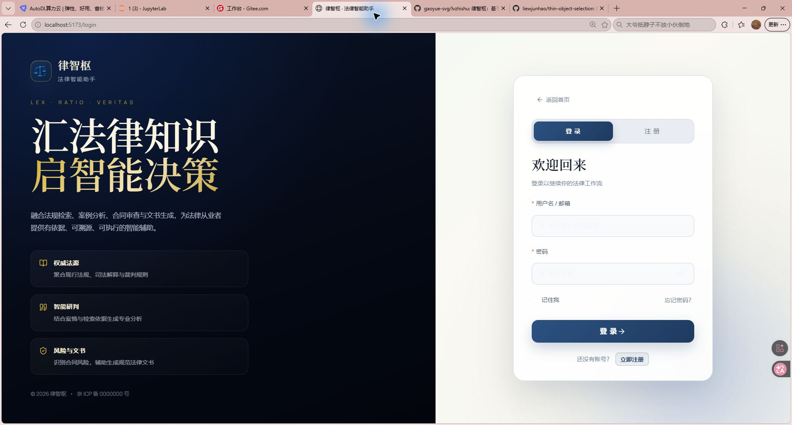

# 律智枢

律智枢是一个基于 **RAG 与多 Agent 编排** 的法律智能工作台，面向法律咨询、法规检索、案例分析、合同审查和法律文书辅助等场景。

> 本项目提供法律信息检索与智能辅助，不替代律师的正式法律意见。

## 项目截图



## 主要功能

- 法律智能问答：支持多轮对话、流式回答与引用来源展示
- 法律法规检索：结合关键词与向量检索定位相关法条
- 案例分析：检索相似案例并提取裁判观点
- 合同审查：识别风险条款，输出风险等级与修改建议
- 法律文书辅助：根据事实和材料生成文书草稿
- 知识库管理：支持文档上传、解析、切分、向量化与检索
- 会话记忆：通过 Redis 保存近期窗口和长期摘要
- 运营监控：记录 Agent 链路、模型用量、RAG 指标和评估结果

## 技术栈

- 前端：Vue 3、TypeScript、Vite、Element Plus、Pinia、ECharts
- 后端：FastAPI、SQLAlchemy、MySQL、Redis
- 检索：Milvus、BM25、混合检索、Rerank、引用校验
- AI：LLM、Embedding、LangGraph、Supervisor、多 Agent 编排
- 文档处理：RapidOCR、PDF/Word 解析、对象存储

## 项目结构

```text
├─ frontend/           Vue 3 前端
├─ backend/            FastAPI 业务接口与服务
├─ agent_service/      Agent、编排、记忆、评估与护栏
├─ rag_service/        混合检索、重排与引用构建
├─ embedding_service/  文档向量化服务
├─ docker/             本地基础设施配置
├─ sql/                数据库初始化脚本
├─ tests/              自动化测试
└─ doc/                项目设计文档
```

## 快速开始

### 1. 获取代码

```bash
git clone https://github.com/gaoyue-svg/lvzhishu.git
cd lvzhishu
```

### 2. 配置环境变量

复制示例文件并填写本地配置：

```bash
cp .env.example .env
```

真实的 API Key、数据库密码和访问密钥只应保存在本地 `.env` 中，不要提交到仓库。

### 3. 安装并启动后端

```bash
uv sync
uv run uvicorn backend.main:app --reload --port 8000
```

### 4. 安装并启动前端

```bash
cd frontend
npm install
npm run dev
```

访问 `http://localhost:5173`。开发环境下，Vite 会将 `/api` 请求代理到 `http://localhost:8000`。

### 5. 可选基础设施

```bash
docker compose -f docker/docker-compose.yml up -d
```

MySQL、Redis、Milvus 等连接信息请参考 `.env.example`，数据库结构见 `sql/init.sql`。

## 测试与构建

```bash
# 后端测试
uv run python -m unittest discover -s tests -v

# 前端构建
cd frontend
npm run build
```

## 安全说明

- `.env`、证书、私钥和本地运行数据已加入 `.gitignore`
- `.env.example` 只保留示例值和空配置项
- 请勿在 Issue、日志或提交记录中公开 API Key

