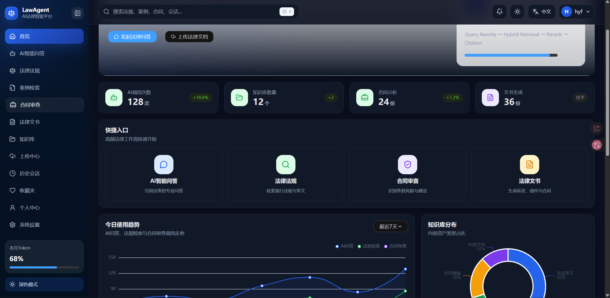
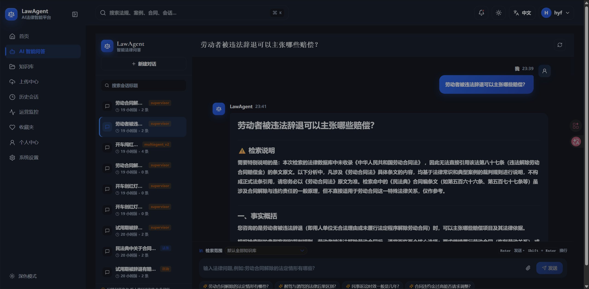
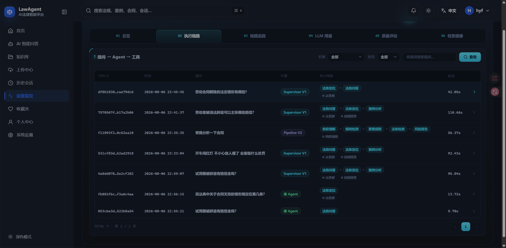
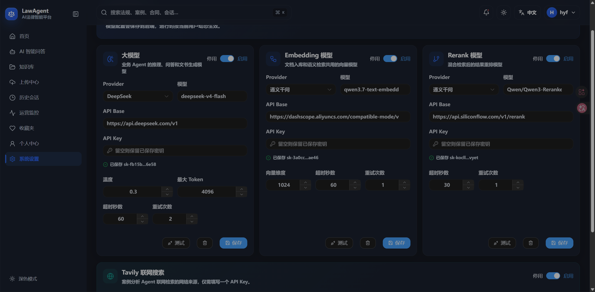

# LawAgent

## 🚀 Build Your Own Legal AI Agent

LawAgent 是一个开源的法律智能 Agent 平台，
探索如何使用 **LLM + RAG + Multi-Agent** 构建下一代 AI 应用。

面对海量法律法规、司法案例和企业合同，
传统搜索只能找到答案，而 LawAgent 希望让 AI 真正理解法律知识。

通过知识库增强、智能路由、多 Agent 协作和深度检索，
LawAgent 可以帮助用户完成：

✨ 法律知识问答  
✨ 法规条款精准定位  
✨ 相似案例检索分析  
✨ 合同智能审查  
✨ 法律文书辅助生成  

同时，它也是一个面向 AI 开发者的学习与实践项目，
从模型调用、Embedding、向量检索、RAG Pipeline，
到 Agent 架构设计、任务规划和智能评估，
完整探索构建企业级 AI Agent 的工程路径。

让每一位开发者，都能参与构建未来的法律智能助手。
---

## 项目截图

### 首页 Dashboard



### AI 对话



### 多 Agent 执行线路



### LLM 模型配置



---

## 目录

- [项目介绍](#项目介绍)
- [技术栈](#技术栈)
- [项目结构](#项目结构)
- [环境要求](#环境要求)
- [快速开始](#快速开始)
- [配置说明](#配置说明)
- [独立 Worker](#独立-worker)
- [测试](#测试)
- [部署](#部署)
- [开发规范](#开发规范)
- [项目路线图](#项目路线图)

---

## 项目介绍

### 定位

LegalMind AI 不只是单纯的法律 RAG 问答系统，而是企业级法律智能知识平台。核心能力：

- **知识库管理**：支持 PDF / Word / TXT / HTML 文档上传、解析、OCR、Chunk 切分、Embedding 向量化
- **混合检索**：BM25 + Milvus 向量检索 + RRF 融合 + 规则重排 + 引用构建
- **多 Agent 编排**：法律咨询、案例分析、合同审查、法条定位等多业务 Agent 协同
- **合同审查**：上传合同文件，自动识别风险点并生成结构化报告
- **Harness 治理层**：可观测性、护栏、评估、A/B 实验一体化治理中间件

### 核心模块

| 模块 | 说明 |
| --- | --- |
| 用户与鉴权 | 注册、登录、JWT、角色权限 |
| 知识库 | CRUD、文档上传、解析状态、Chunk 查看 |
| AI 问答 | 多轮聊天、SSE 流式输出、引用展示、历史会话 |
| Agent | 法律咨询 / 案例分析 / 合同审查 / 法条定位 |
| 合同审查 | 条款理解 / 规则检测 / 法条检索 / 要素提取 / 风险报告 |
| 后台管理 | Dashboard、知识库管理、文档管理、模型配置 |
| 运营监控 | Agent Trace、LLM 用量、RAG 指标、评估结果 |

### 业务 Agent

| Agent | 功能 |
| --- | --- |
| `law_qa` | 面向一般法律问题，返回法规依据和建议 |
| `case_analysis` | 检索相似案例，提取裁判观点 |
| `contract_review` | 识别合同风险、输出风险等级和修改建议 |
| `article_locate` | 根据问题定位法律、章节、条款和版本 |

---

## 技术栈

### 后端

- **框架**：FastAPI + Uvicorn（单一应用聚合业务/Agent/RAG 三处路由）
- **数据库**：MySQL 8.0+（SQLAlchemy 2.0 async + aiomysql）
- **缓存**：Redis 5.0+（短期记忆、Embedding 缓存、任务队列 Stream）
- **向量库**：Milvus 3.0（单 Collection `lawrag_chunks`，只存检索过滤标量字段）
- **对象存储**：阿里云 OSS（文档与报告存储）
- **RAG**：BM25（rank-bm25）+ Milvus + RRF 融合 + 规则重排
- **Embedding**：OpenAI 兼容接口（默认 `text-embedding-3-small`，1536 维）
- **多 Agent**：LangGraph 编排（Supervisor V1 / 多 Agent v2 双链路）
- **OCR**：RapidOCR（onnxruntime 后端）+ 阿里云 OCR（可选）
- **任务队列**：Redis Stream（解析 / 向量化 / 合同审查 / 评估 四条流）
- **治理**：Prometheus 指标 + LLM Usage 采集 + 在线/离线评估 + A/B 实验
- **LLM**：BYOK（用户自带 Key，按用户隔离，Fernet 加密），支持 DeepSeek / OpenAI 兼容协议

### 前端

- **框架**：Vue 3.5 + TypeScript 5.7
- **构建**：Vite 6
- **UI**：Element Plus 2.9 + UnoCSS
- **状态**：Pinia
- **路由**：Vue Router 4
- **图表**：ECharts 5
- **HTTP**：Axios + 原生 fetch（SSE 流式）
- **Markdown**：markdown-it + dompurify

### 基础设施

- **Python**：>=3.12（依赖管理用 uv）
- **Node**：>=18
- **容器**：Docker / Docker Compose（Milvus + etcd + MinIO）

---

## 项目结构

```
LawAgent/
├── backend/                # FastAPI 后端（业务路由、服务、ORM、Worker、OSS）
│   ├── routers/            # 业务路由：auth/kb/document/chunk/contract/...
│   ├── services/           # 业务服务：parser/ocr/llm_config/...
│   ├── models/             # SQLAlchemy ORM 模型
│   ├── schemas/            # Pydantic Schema
│   ├── middleware/         # 异常处理、trace_id
│   ├── worker/             # 解析 / 合同审查 / 评估 Worker
│   ├── storage/            # OSS 封装
│   ├── utils/              # 通用工具（tokenizer/crypto/logger）
│   ├── config.py           # 配置加载（pydantic-settings）
│   ├── database.py         # 数据库初始化
│   └── main.py             # FastAPI 入口（lifespan 装配所有依赖）
├── rag_service/            # 阶段三 RAG 检索服务
│   ├── retrieval/          # bm25/milvus/retriever/reranker/citation/...
│   ├── routers/            # /api/retrieve 调试接口
│   └── schemas/            # 检索 Schema
├── embedding_service/      # 阶段三 Embedding 向量化服务
│   ├── embedding/          # context_enhancer/embedding/embedding_cache
│   ├── services/           # 任务入队、向量清理、缓存查询
│   └── worker/             # 独立向量化 Worker
├── agent_service/          # 多 Agent 系统
│   ├── agents/             # 业务 Agent + Supervisor + Registry + cards/
│   ├── orchestrator/       # 多 Agent v2 编排（pipeline/plan/executor/reviewer）
│   ├── router/             # Router Agent（纯决策层）
│   ├── llm/                # LLM 抽象、BYOK、Usage 采集
│   ├── guard/              # Input Guard 护栏
│   ├── evaluator/          # 在线/离线评估
│   ├── experiment/         # A/B 实验
│   ├── metrics/            # Prometheus 指标
│   ├── tools/              # Agent 工具（article/contract/web_search）
│   ├── prompts/            # Prompt 模板（md/）+ loader
│   ├── citation/           # 引用校验
│   ├── memory/             # Redis 短期记忆
│   ├── mcp/                # MCP 客户端
│   └── routers/            # /api/agent（SSE 对话引擎）
├── frontend/               # Vue 3 前端
│   └── src/
│       ├── pages/          # dashboard/assistant/knowledge/monitor/...
│       ├── api/            # 接口封装
│       ├── stores/         # Pinia store
│       └── router/         # 路由与菜单
├── sql/
│   ├── init.sql            # 数据库全量初始化脚本
│   └── migrations/         # 增量迁移脚本
├── docker/
│   └── docker-compose.yml  # Milvus + etcd + MinIO
├── doc/                    # 产品/架构/接口/数据库设计文档
├── picture/                # 项目截图
├── scripts/                # 辅助脚本与示例数据
├── storage/                # BM25 索引等本地存储
├── tests/                  # unittest 测试套件
├── pyproject.toml          # Python 依赖（uv 管理）
├── AGENTS.md               # 仓库开发指南（分阶段现状与规范）
└── CLAUDE.md               # 系统级架构补充与命令速查
```

> 详细分阶段现状与编码规范见 [AGENTS.md](./AGENTS.md)，系统级架构与命令速查见 [CLAUDE.md](./CLAUDE.md)。

---

## 环境要求

| 组件 | 版本 | 说明 |
| --- | --- | --- |
| Python | >=3.12 | 推荐 3.13/3.14 |
| Node.js | >=18 | 前端构建 |
| MySQL | 8.0+ | 业务数据库 |
| Redis | 5.0+ | 缓存、记忆、任务队列 |
| Milvus | 3.0 | 向量检索（不可用时降级 BM25） |
| Docker | 20+ | 启动 Milvus 等基础设施 |

---

## 快速开始

### 1. 克隆仓库

```bash
git clone <repo-url>
cd LawAgent
```

### 2. 启动基础设施（Milvus + etcd + MinIO）

```bash
docker compose -f docker/docker-compose.yml up -d
```

> MySQL 与 Redis 默认连接本机 `127.0.0.1:3306` 与 `127.0.0.1:6379`，请自行启动。

### 3. 初始化数据库

```bash
mysql -u root -p < sql/init.sql
```


### 4. 配置环境变量

在项目根目录创建 `.env` 文件（参考 [配置说明](#配置说明)）：

```bash
# 数据库
MYSQL_HOST=127.0.0.1
MYSQL_PORT=3306
MYSQL_USER=root
MYSQL_PASSWORD=your_password
MYSQL_DATABASE=lawrag

# Redis
REDIS_URL=redis://127.0.0.1:6379/4

# JWT
JWT_SECRET=please-change-to-a-random-string-at-least-32-chars

# Milvus
MILVUS_HOST=127.0.0.1
MILVUS_PORT=19530

# Embedding（推荐使用 OpenAI 兼容接口）
EMBEDDING_PROVIDER=openai
EMBEDDING_MODEL=text-embedding-3-small
EMBEDDING_DIM=1536
EMBEDDING_API_BASE=https://api.openai.com/v1
EMBEDDING_API_KEY=sk-xxx

# 全局 LLM（用户未配置 BYOK 时回退使用）
LLM_PROVIDER=deepseek
LLM_MODEL=deepseek-chat
LLM_API_BASE=https://api.deepseek.com/v1
LLM_API_KEY=sk-xxx

# OSS（阿里云对象存储）
OSS_ENDPOINT=https://oss-cn-hangzhou.aliyuncs.com
OSS_ACCESS_KEY_ID=your_key_id
OSS_ACCESS_KEY_SECRET=your_key_secret
OSS_DOCUMENTS_BUCKET=lawrag-documents
OSS_REPORTS_BUCKET=lawrag-reports
```

完整配置项见 [backend/config.py](./backend/config.py) 与下方 [配置说明](#配置说明)。

### 5. 安装后端依赖

```bash
uv sync
```

### 6. 启动后端

```bash
uv run uvicorn backend.main:app --reload --port 8000
```

- Swagger 文档：http://localhost:8000/docs
- 默认开发环境 `inline_workers=true`，后端进程已内嵌解析/向量化/合同审查/评估四个 Worker，无需单独启动

验证后端可正常导入：

```bash
uv run python -c "import backend.main; import embedding_service.worker.embedding; print('import ok')"
```

### 7. 启动前端

```bash
cd frontend
npm install
npm run dev
```

- 前端访问：http://localhost:5173
- Vite 已配置 `/api` 代理到 `http://localhost:8000`，无跨域问题

---

## 配置说明

所有运行配置通过 `.env` 文件注入，由 `backend/config.py` 的 `Settings` 加载。主要配置分组如下：

### 应用基础

| 配置项 | 默认值 | 说明 |
| --- | --- | --- |
| `APP_ENV` | development | 运行环境 |
| `APP_NAME` | LawAgent | 应用名 |
| `APP_DEBUG` | true | 调试模式 |
| `CORS_ORIGINS` | * | CORS 允许来源 |

### 数据库与缓存

| 配置项 | 默认值 | 说明 |
| --- | --- | --- |
| `MYSQL_HOST` | 127.0.0.1 | MySQL 主机 |
| `MYSQL_PORT` | 3306 | MySQL 端口 |
| `MYSQL_USER` | root | MySQL 用户 |
| `MYSQL_PASSWORD` | 123456 | MySQL 密码 |
| `MYSQL_DATABASE` | lawrag | 数据库名 |
| `MYSQL_POOL_SIZE` | 10 | 连接池大小 |
| `MYSQL_MAX_OVERFLOW` | 20 | 连接池溢出上限 |
| `REDIS_URL` | redis://127.0.0.1:6379/4 | Redis 连接 URL |

### 鉴权

| 配置项 | 默认值 | 说明 |
| --- | --- | --- |
| `JWT_SECRET` | change-me-... | JWT 签名密钥（**生产必须修改**） |
| `JWT_ALGORITHM` | HS256 | JWT 算法 |
| `ACCESS_TOKEN_EXPIRE_MINUTES` | 4320 | Access Token 有效期（分钟） |
| `REFRESH_TOKEN_EXPIRE_DAYS` | 3 | Refresh Token 有效期（天） |

### OSS（阿里云对象存储）

| 配置项 | 默认值 | 说明 |
| --- | --- | --- |
| `OSS_ENDPOINT` | https://oss-cn-hangzhou.aliyuncs.com | OSS 接入点 |
| `OSS_ACCESS_KEY_ID` | （空） | OSS AccessKey ID |
| `OSS_ACCESS_KEY_SECRET` | （空） | OSS AccessKey Secret |
| `OSS_DOCUMENTS_BUCKET` | lawrag-documents | 文档桶 |
| `OSS_REPORTS_BUCKET` | lawrag-reports | 报告桶 |

### Milvus 与 Embedding

| 配置项 | 默认值 | 说明 |
| --- | --- | --- |
| `MILVUS_HOST` | 127.0.0.1 | Milvus 主机 |
| `MILVUS_PORT` | 19530 | Milvus 端口 |
| `EMBEDDING_PROVIDER` | openai | Embedding provider |
| `EMBEDDING_MODEL` | text-embedding-3-small | Embedding 模型 |
| `EMBEDDING_DIM` | 1536 | 向量维度（**须与已有 Collection 维度一致**） |
| `EMBEDDING_API_BASE` | （空） | Embedding API 地址 |
| `EMBEDDING_API_KEY` | （空） | Embedding API Key |
| `MAX_EMBEDDING_TOKENS` | 500 | 单 Chunk Embedding token 上限 |
| `EMBEDDING_BATCH_SIZE` | 100 | Embedding 批量大小 |
| `EMBEDDING_CACHE_ENABLED` | true | 是否启用 Embedding 缓存 |
| `BM25_INDEX_DIR` | storage/bm25 | BM25 索引目录 |
| `TOKENIZER_PROVIDER` | jieba | 分词器 |
| `CONTEXT_MAX_TOKENS` | 4000 | 上下文最大 token |

### LLM 与 BYOK

| 配置项 | 默认值 | 说明 |
| --- | --- | --- |
| `LLM_PROVIDER` | deepseek | 全局 LLM provider |
| `LLM_MODEL` | deepseek-chat | 全局 LLM 模型 |
| `LLM_API_BASE` | （空） | LLM API 地址 |
| `LLM_API_KEY` | （空） | LLM API Key |
| `LLM_TEMPERATURE` | 0.3 | 温度 |
| `LLM_MAX_TOKENS` | 4096 | 最大 token |
| `LLM_TIMEOUT` | 60 | 超时秒数 |
| `LLM_RETRY` | 2 | 重试次数 |
| `BYOK_ENABLED` | true | 是否启用用户自带 Key |
| `BYOK_FALLBACK_TO_GLOBAL` | true | 用户未配置时是否回退全局 Key |
| `LLM_CONFIG_SECRET` | （空） | BYOK 加密密钥（空则派生自 JWT_SECRET，仅限开发） |

### 多 Agent 编排

| 配置项 | 默认值 | 说明 |
| --- | --- | --- |
| `SUPERVISOR_ENABLED` | true | 启用 Supervisor V1 多 Agent |
| `MULTIAGENT_V2_ENABLED` | false | 多 Agent v2 灰度开关 |
| `SUPERVISOR_MAX_ROUNDS` | 5 | Supervisor 最大决策轮次 |
| `SUPERVISOR_MAX_AGENT_CALLS` | 2 | 同一 Agent 最多调用次数 |
| `PLAN_MAX_STEPS` | 4 | v2 单次计划最大步数 |
| `STEP_TIMEOUT` | 60.0 | v2 单步超时秒数 |
| `REVIEW_L2_ENABLED` | true | v2 L2 抽样审查 |
| `SYNTH_CONTEXT_MAX_TOKENS` | 3000 | 合成层上下文 token 上限 |

### 查询改写

| 配置项 | 默认值 | 说明 |
| --- | --- | --- |
| `QUERY_REWRITE_ENABLED` | true | 启用查询改写 |
| `QUERY_REWRITE_LLM_ENABLED` | false | 启用 LLM 增强（默认仅规则） |

### Router Agent

| 配置项 | 默认值 | 说明 |
| --- | --- | --- |
| `ROUTER_CONFIDENCE_THRESHOLD` | 0.6 | 置信度阈值（低于则降级 law_qa） |
| `ROUTER_CONFIDENCE_MAX` | 0.95 | 置信度上限 |
| `ROUTER_LLM_TIMEOUT` | 8 | 决策超时秒数 |

### 联网搜索

| 配置项 | 默认值 | 说明 |
| --- | --- | --- |
| `WEB_SEARCH_PROVIDER` | tavily | 搜索 provider：tavily / bing_mcp |
| `TAVILY_API_KEY` | （空） | Tavily API Key |
| `TAVILY_MAX_RESULTS` | 5 | 最大结果数 |
| `MCP_ENABLED` | false | MCP 客户端总开关 |
| `BING_MCP_SERVER_URL` | （空） | 必应搜索 MCP 服务器地址 |

### OCR

| 配置项 | 默认值 | 说明 |
| --- | --- | --- |
| `OCR_PROVIDER` | rapidocr | OCR 引擎：rapidocr / none |
| `OCR_MIN_CHARS_PER_PAGE` | 50 | PDF 每页平均字符数低于此值视为扫描件 |
| `ALIYUN_OCR_ENABLED` | false | 启用阿里云 OCR（按量计费） |
| `ALIYUN_OCR_ACCESS_KEY_ID` | （空） | 阿里云 AccessKey ID |
| `ALIYUN_OCR_ACCESS_KEY_SECRET` | （空） | 阿里云 AccessKey Secret |
| `ALIYUN_OCR_REGION` | cn-shanghai | 阿里云 OCR 接入点区域 |

> ⚠️ 项目使用 **RapidOCR**（onnxruntime 后端），不使用 PaddleOCR（paddlepaddle 无 Python 3.14 wheel）。

### 文档解析

| 配置项 | 默认值 | 说明 |
| --- | --- | --- |
| `MINERU_ENABLED` | false | 启用 MinerU 版面解析 |
| `MINERU_API_URL` | （空） | MinerU 服务地址 |
| `MINERU_TIMEOUT_SECONDS` | 3600 | MinerU 超时秒数 |

### Worker

| 配置项 | 默认值 | 说明 |
| --- | --- | --- |
| `INLINE_WORKERS` | true | 开发环境内嵌 Worker（生产建议 false） |

### Harness 治理层

| 配置项 | 默认值 | 说明 |
| --- | --- | --- |
| `HARNESS_ENABLED` | true | Harness 总开关 |
| `HARNESS_TRACE_ENABLED` | true | agent_run_trace 落库 |
| `HARNESS_METRICS_ENABLED` | true | Prometheus 指标 |
| `LLM_USAGE_ENABLED` | true | LLM 用量采集 |
| `EVALUATION_ENABLED` | true | 在线确定性评估 |
| `EVALUATION_SAMPLE_RATE` | 0.05 | 离线 LLM 评审抽样率 |
| `EXPERIMENT_ENABLED` | true | A/B 实验开关 |

### Input Guard 护栏

| 配置项 | 默认值 | 说明 |
| --- | --- | --- |
| `GUARD_ENABLED` | true | 护栏总开关 |
| `GUARD_MAX_QUERY_CHARS` | 4000 | 单条 query 最大字符数 |
| `GUARD_MAX_UPLOAD_FILES` | 10 | 单次会话最大上传文件数 |
| `GUARD_PROMPT_INJECTION_ENABLED` | true | 提示注入检测 |
| `GUARD_BLOCKED_KEYWORDS` | （空） | 敏感词表（逗号分隔） |
| `GUARD_REQUEST_TOKEN_CAP` | 4000 | 单请求 token 上限（0=不限） |
| `GUARD_USER_DAILY_TOKEN_QUOTA` | 200000 | 单用户每日 token 配额 |
| `GUARD_MAX_CONCURRENCY` | 3 | 单用户并发会话上限 |

---

## 独立 Worker

开发环境默认 `inline_workers=true`，后端进程已内嵌四个 Worker，无需手动启动。生产环境建议设为 `false`，使用独立 Worker 进程横向扩展：

```bash
# 文档解析 Worker
uv run python -m backend.worker.parser

# 向量化 Worker
uv run python -m embedding_service.worker.embedding

# 合同规则审查 Worker
uv run python -m backend.worker.contract_review

# 离线 LLM 评估 Worker（消费 evaluation 流）
uv run python -m backend.worker.evaluator
```

四条 Redis Stream：

| Stream | 用途 |
| --- | --- |
| `lawrag:stream:document_parse` | 文档解析 |
| `lawrag:stream:chunk_embedding` | Chunk 向量化 |
| `lawrag:stream:contract_review` | 合同规则审查 |
| `lawrag:stream:evaluation` | 离线 LLM 评估 |

---

## 测试

测试使用 **unittest** 风格 + 桩（FakeLLM 等），不依赖真实 MySQL/Redis/OSS/Milvus。

```bash
# 语法检查
uv run python -m compileall backend rag_service embedding_service tests

# 运行单个测试模块
uv run python -m unittest tests.test_retrieval_core -v

# 运行全部测试
uv run python -m unittest discover -s tests -v
```

前端：

```bash
cd frontend
npm run lint     # eslint --fix
npm run build    # vue-tsc 类型检查 + vite build
```

---

## 部署

### 后端

```bash
uv sync
uv run uvicorn backend.main:app --host 0.0.0.0 --port 8000
```

生产环境建议：

- `INLINE_WORKERS=false`，独立 Worker 进程
- `APP_DEBUG=false`
- 修改 `JWT_SECRET` 为强随机字符串
- 配置 `LLM_CONFIG_SECRET` 用于 BYOK 加密
- 配置 `CORS_ORIGINS` 为具体域名

### 前端

```bash
cd frontend
npm run build
# 将 dist/ 部署到 Nginx 等 Web 服务器，/api 反向代理到后端
```

### 基础设施

```bash
docker compose -f docker/docker-compose.yml up -d   # Milvus + etcd + MinIO
```

MySQL 与 Redis 请按生产规范独立部署。

---

## 开发规范

- **包目录**：使用下划线命名（`rag_service`、`embedding_service`），不要使用连字符
- **代码注释**：每个文件头部用中文注释说明作用，关键处加中文注释
- **命名**：函数/变量/模块 `snake_case`，类 `PascalCase`
- **类型**：优先使用类型标注和 SQLAlchemy 2.0 `Mapped` 风格
- **接口**：统一返回 `ApiResponse[T]`
- **数据库**：使用 `AsyncSession`，避免同步阻塞
- **降级**：一切优雅降级（LLM 失败→规则兜底，工具失败→`available=false`，Milvus 不可用→BM25）
- **任务队列**：单条消息必须 `try/finally` ACK，坏消息不能拖垮 Worker
- **Milvus**：只存检索过滤所需标量字段，完整 metadata 以 MySQL 为权威，检索后批量回查
- **Embedding 缓存 key**：必须包含 `tenant_id`、`provider`、`model`、`dimension` 和增强文本 SHA256
- **引用合并**：跨 Agent 最终答案的 `[n]` 引用必须基于全局合并后的 citation 列表重编号

详细规范见 [AGENTS.md](./AGENTS.md) 与 [doc/10-开发规范.md](./doc/10-开发规范.md)。

---

## 项目路线图

| 阶段 | 状态 | 目标 |
| --- | --- | --- |
| 阶段一：基础工程 | ✅ | FastAPI + Vue 骨架、用户鉴权、日志 trace_id |
| 阶段二：知识库与文档入库 | ✅ | OSS/Parser/Chunk、PDF/Word 解析、OCR |
| 阶段三：Embedding 与检索 | ✅ | Milvus、BM25、Hybrid Retriever、Rerank、Retrieval Lab |
| 阶段四：AI 问答 | ✅ | LLM + 流式 + Citation Validator、多轮会话 |
| 阶段五：Agent 能力 | ✅ | LangGraph 编排、合同审查、案例分析、Router Agent |
| 阶段六：后台商业化 | 🚧 | Prompt 管理、Agent Builder、日志中心、Harness 治理 |
| 阶段七：高级能力 | ⬜ | 知识图谱、GraphRAG、自动更新、多模态 |

详细路线图见 [doc/12-项目路线图.md](./doc/12-项目路线图.md)。

---

## 文档

完整设计文档位于 [doc/](./doc/) 目录：

- [01-产品需求(PRD)](./doc/01-产品需求(PRD).md)
- [02-系统架构设计](./doc/02-系统架构设计.md)
- [03-数据库设计](./doc/03-数据库设计.md)
- [04-RAG设计](./doc/04-RAG设计.md)
- [05-Agent设计](./doc/05-Agent设计.md)
- [06-知识库设计](./doc/06-知识库设计.md)
- [07-接口设计(OpenAPI)](./doc/07-接口设计(OpenAPI).md)
- [08-前端设计](./doc/08-前端设计.md)
- [09-部署方案](./doc/09-部署方案.md)
- [10-开发规范](./doc/10-开发规范.md)
- [11-测试方案](./doc/11-测试方案.md)
- [12-项目路线图](./doc/12-项目路线图.md)
- [16-Agent设计方案](./doc/16-Agent设计方案.md)
- [17-Router Agent 设计方案](./doc/17-Router%20Agent%20设计方案.md)
- [19-多Agent编排与治理方案](./doc/19-多Agent编排与治理方案.md)
- [20-MCP接入方案](./doc/20-MCP接入方案.md)
- [21-AgentHarness治理中间件方案](./doc/21-AgentHarness治理中间件方案.md)

---

## License

本项目为内部工程，未开源。
